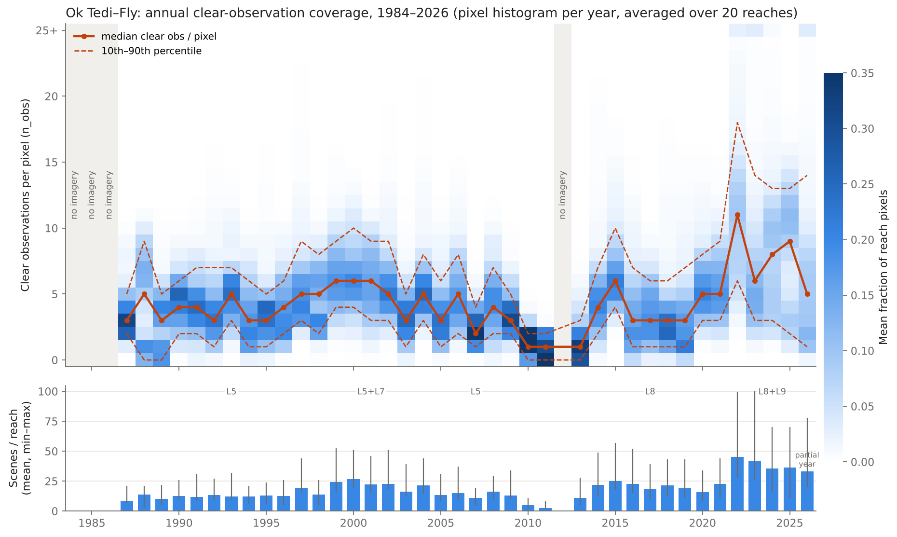

# Water-mask extraction (step `extract_masks`)

How RivMapper v2 extracts annual Landsat water observations for each reach from Google Earth Engine. Code: [`rivmapper_v2/gee.py`](../../rivmapper_v2/gee.py) (everything that talks to Earth Engine) and [`rivmapper_v2/masks.py`](../../rivmapper_v2/masks.py) (step logic). Grid and value conventions: [conventions.md](conventions.md).

## Summary

For every reach polygon and calendar year, the step counts, pixel by pixel, how many clear Landsat observations there were and how many of them were classified as water at each of the four DSWE confidence levels (Jones, 2019). These counts are downloaded on the river's fixed 30 m grid as one five-band GeoTIFF per reach-year.

**Design principle: the raw product is a faithful record of what Earth Engine provides.** Raw extraction applies no multi-year compositing window, no DSWE threshold and no percentile. Those choices are made later, in mask processing, from the counts. They can therefore be compared or calibrated per river without downloading anything again.

**Why water, not "active channel".** RivMapper measures reworking: flow moving onto ground it did not occupy, or leaving ground it did. An active-channel classification (water plus unvegetated bars) hides exactly this in braided and wandering rivers. An abandoned thread stays bare, so it remains "active channel" for years after the flow has left. The water mask records each switch. The stage dependence of water extent is handled in processing, through the DSWE level, the percentile and year-to-year consistency checks. It is not handled by widening the class.

## Workflow

For each river (reach polygons from the `reaches` step must exist):

1. **Fix the grid.**
   - The river's grid origin is the top-left corner of the union of its reach polygons, snapped outward to a multiple of 30 m in the analysis CRS.
   - Each reach gets the smallest window of that grid that covers its polygon.
   - Every reach and every year therefore line up pixel for pixel.
2. **Select scenes.**
   - For reach *r* and year *Y*, take all Landsat Collection 2 Level 2 Tier 1 scenes acquired from 1 January to 31 December of *Y* whose footprints intersect the reach polygon (see *Imagery*).
   - Their number is logged as `n_scenes`.
3. **Mask each scene.** Pixels flagged in `QA_PIXEL` as fill, dilated cloud, cirrus, cloud, cloud shadow or snow are removed. What remains is a *clear observation*.
4. **Classify each clear observation with DSWE** (see *Water classification*), giving class 0–4 per pixel.
5. **Count.**
   - Each scene yields five binary layers: clear (any class), class 1, class 1–2, class 1–3 and class 1–4.
   - Masked pixels contribute 0 to every layer.
   - The layers are summed over all scenes in *Y* to give `n_obs`, `n_wet_1` … `n_wet_4` (see *Annual counts*).
6. **Download on the grid.**
   - Counts are fetched with Earth Engine `computePixels` on an explicit pixel grid (CRS + affine transform), in tiles (see *Download*).
   - Earth Engine does the only reprojection, by nearest neighbour.
7. **Mask to the polygon and write.**
   - Pixels whose centre lies outside the reach polygon are set to 255 (nodata) in every band.
   - The file is written to `raw/{river}_r{NNN}_{year}.tif`, with its settings fingerprint, scene count and provenance in the GeoTIFF tags.
   - Years with no scenes still get a file (all `n_obs = 0`) and are logged as `no_imagery`.
8. **Log and record.**
   - One row per reach-year goes to `{river}_extract_masks_log.csv`.
   - A run record, `{river}_extract_masks_run.yaml`, stores the parameters, analysis CRS, grid origin, package versions and status counts.

The step is **resumable**. On re-run, any reach-year file whose stored fingerprint matches the current settings is skipped without contacting Earth Engine, so an interrupted or partly failed run only fetches what is missing.

## Imagery

- **Sources:** Landsat Collection 2, Level 2 surface reflectance, Tier 1.
  - Landsat 5 TM (1984–2011), Landsat 8 OLI (2013–) and Landsat 9 OLI-2 (late 2021–): full record.
  - Landsat 7 ETM+: only 15 Apr 1999 – 30 May 2003, before the scan-line-corrector failure.
- **Bands:** harmonised names Blue, Green, Red, NIR, SWIR1, SWIR2. Surface reflectance = DN × 0.0000275 − 0.2. No cross-sensor reflectance adjustment is applied (see *Limitations*).
- **Pixel masking:** `QA_PIXEL` bits 0 (fill), 1 (dilated cloud), 2 (cirrus), 3 (cloud), 4 (cloud shadow) and 5 (snow) are masked.
  - *This fixes a bug in the v1 and June-2026 notebooks.* They used Collection 1 bit positions (3 = shadow, 5 = cloud) on Collection 2 data. As a result they masked cloud (bit 3) and snow (bit 5), but never cloud shadow or dilated cloud. Shadows are dark and can be classified as water.

## Water classification

Each clear observation is classified with the Dynamic Surface Water Extent tests of Jones (2019), applied to surface reflectance:

| Test | Condition |
|---|---|
| 1 | MNDWI > 0.124 |
| 2 | (Green + Red) > (NIR + SWIR1) |
| 3 | AWEsh = Blue + 2.5·Green − 1.5·(NIR + SWIR1) − 0.25·SWIR2 > 0 |
| 4 | MNDWI > −0.44, SWIR1 < 0.09, NIR < 0.15 and NDVI < 0.7 |
| 5 | MNDWI > −0.5, Blue < 0.10, SWIR1 < 0.30, SWIR2 < 0.10 and NIR < 0.25 |

Here MNDWI = (Green − SWIR1)/(Green + SWIR1) and NDVI = (NIR − Red)/(NIR + Red).

The five pass/fail results form a code that maps to:
- 0, not water;
- 1, high-confidence water (four or five tests pass);
- 2, moderate-confidence water (three pass);
- 3, potential wetland (code 11000);
- 4, low-confidence or partial-surface water (test 5 alone, or two tests other than the 4 + 5 pair).

A single pass of any of tests 1–4 alone is class 0.

The full code lists are in `gee.dswe()`.

## Annual counts (the raw product)

For each reach and calendar year *Y*, over every clear scene acquired from 1 January to 31 December of *Y*:

| Band | Count |
|---|---|
| `n_obs` | Clear observations (not masked by `QA_PIXEL`) |
| `n_wet_1` | Observations with DSWE class 1 |
| `n_wet_2` | Observations with DSWE class 1–2 |
| `n_wet_3` | Observations with DSWE class 1–3 |
| `n_wet_4` | Observations with DSWE class 1–4 |

- The counts are nested: `n_wet_1 ≤ n_wet_2 ≤ n_wet_3 ≤ n_wet_4 ≤ n_obs`.
- Counts are capped at 254 so that 255 stays free for nodata. The highest count on the Ok Tedi is 48.
- `n_obs = 0` inside the polygon means no clear observation that year. That is not the same as dry.

**From counts to a water mask (processing, planned).**
- For DSWE level *k*, a pixel's wet frequency in year *Y* is *f* = `n_wet_k / n_obs`.
- A per-pixel percentile *p* of the binary wet/dry series is then a threshold on *f*. For example, the median (*p* = 50) means water where *f* ≥ 0.5.
- Pixels with `n_obs = 0` are no data.
- Choosing *k* and *p* per river is a processing-step decision. Options include width matching, SWOT-era calibration, sensitivity plateaus and sensor-transition consistency.

## Download

- **Grid:** each reach-year is downloaded on the river's fixed 30 m grid in the analysis CRS ([conventions.md](conventions.md)). The download uses `computePixels` with an explicit pixel grid, so no local resampling or mosaicking is ever needed.
- **Chunking:** reaches are fetched in chunks of up to `chunk_px` × `chunk_px` pixels (default 2048) and assembled locally.
- **Adaptive tiling:**
  - Earth Engine's memory use grows with pixels × scenes. A chunk that is fine in most years can therefore fail on a large reach in a dense year, typically 2022 onward, when Landsat 8 and 9 overlap on adjacent paths.
  - If a chunk fails with a memory, request-size or time-limit error, it is split into quadrants and retried, recursively, down to `min_chunk_px` (default 256).
  - Any other error (authentication, invalid geometry) fails immediately.
  - Sub-tiles lie on the same grid, so the file is identical to a single download.
  - The log column `n_tiles` records how many requests a reach-year needed.
- **Per-tile scene selection:**
  - Each tile only uses the scenes whose footprints touch that tile (plus a 300 m margin), not every scene touching the reach.
  - Scenes that miss a tile add zero counts there, so results are unchanged and Earth Engine does less work.
  - A tile touched by no scene returns zero counts.

## Example: Ok Tedi–Fly, 1984–2026

20 reaches × 43 years = 860 reach-years. 780 were `ok` and 80 `no_imagery` (1984–86 and 2012 for every reach); none failed. The raw set is about 115 MB.

*Top:* for each year, the share of reach pixels with each clear-observation count. Each reach's histogram is normalised to sum to 1, the 20 reaches are averaged with equal weight, and every column therefore sums to 1. The colour scale is capped at 0.35, so a few cells in 2010–2013 saturate. The orange lines show the median and the 10th–90th percentiles of `n_obs`. *Bottom:* scenes touching each reach, as the mean and min–max across reaches.

| Period | Sensors | Median clear looks per pixel |
|---|---|---|
| 1987–2009 | Landsat 5 (+ 7 in 1999–2003) | 3–6 (best in the Landsat 7 years) |
| 2010–2011 | Landsat 5 failing | 1. In 2011, 47% of pixels were never seen clear. |
| 2012 | none | — |
| 2013 | Landsat 8 from mid-year | 1. 29% of pixels were never seen clear. |
| 2014–2021 | Landsat 8 | 3–6 |
| 2022–2025 | Landsat 8 + 9 | 6–11 |

About 15–45 scenes touch a reach each year, but persistent cloud leaves a typical pixel only a handful of clear looks before 2022. The largest reach (20) needed adaptive tiling in 2022–23, when 71–74 scenes touched it.

## Limitations

- **Observation density is not constant through time.** A percentile composite in a 2–3-observation year rests on one or two scenes, so stage and noise effects are largest in the sparse years. Results should carry `n_obs`, or be weighted or flagged by it, rather than treating every year as equally well observed.
- **Gap years.**
  - 2012 has no imagery while Landsat 7 is excluded.
  - 2010–11 and 2013 are sparse.
  - Over Papua New Guinea, 1984–86 also have no Tier 1 Landsat 5 scenes (presumably acquisition or ground-station gaps; not verified).
  - Options, to be decided in processing:
    - borrow observations from adjacent years;
    - add SLC-off Landsat 7 for gap years only, since annual counts tolerate its striping;
    - treat these years as missing.
- **Partial current year.** The final year (2026 here) only contains scenes acquired up to the extraction date. Re-extract it once the year is complete (`--overwrite` for that year range).
- **No cross-sensor harmonisation.** Surface reflectance from TM/ETM+ (LEDAPS) and OLI (LaSRC) is used as provided. DSWE's thresholds are generous relative to the known TM–OLI offsets, but the effect has not been tested here. Comparing wet frequency across the 2011–2013 sensor change is a planned check.
- **30 m resolution.** Channels and threads narrower than about 2–3 pixels are not resolved, and edge pixels are mixed. DSWE classes 3–4 partly capture mixed water pixels.
- **Residual cloud and shadow.** The `QA_PIXEL` (CFMask) flags miss some thin cloud and shadow. Missed shadow can register as low-confidence water, which is one reason the DSWE level is left as a processing choice.

## Outputs

`{data_root}/{river}/masks/`:

| File | Contents |
|---|---|
| `raw/{river}_r{NNN}_{year}.tif` | uint8, five bands (`n_obs`, `n_wet_1` … `n_wet_4`), nodata 255. Tags hold the product version and settings fingerprint, river, reach, year and scene count. |
| `{river}_extract_masks_log.csv` | One row per reach-year: `status` (`ok`, `no_imagery`, `failed`), `n_scenes`, `n_tiles`, `clear_fraction` (share of the polygon with `n_obs` ≥ 1), `n_obs_median`, `n_obs_p10` and the failure `reason` |
| `{river}_extract_masks_run.yaml` | Run record: parameters, analysis CRS, grid origin, status counts, package versions and git commit |

**Re-runs:**
- Files already made with the same product version and grid are skipped, so an interrupted run resumes.
- Changing `dswe_level` or `percentile` does not invalidate raw files.
- If the product or grid changes after files exist, the step reports `stale` rather than mixing old and new files. Use `--overwrite` to rebuild.

## Parameters (`masks:` in `rivmapper.yaml`; all can be set per river)

| Parameter | Default | Used by |
|---|---|---|
| `year_start`, `year_end` | — (required) | Extraction: calendar years to extract |
| `reach_start`, `reach_end` | all | Extraction: reach range (`ds_order`) |
| `chunk_px` | 2048 | Extraction: download chunk size (pixels per side) |
| `min_chunk_px` | 256 | Extraction: smallest tile a failing chunk is split down to |
| `dswe_level` | — | Processing: water = DSWE class 1..`dswe_level` |
| `percentile` | 50 | Processing: per-pixel percentile of the wet/dry series |
| `min_pixels` | 200 | Processing |

Earth Engine credentials and the Cloud project are set under `gee:` (see the README). Settings from the earlier windowed design (`composite_windows`, `min_clear_fraction`, `min_water_fraction`, `tile_size_km2`) are ignored, with a warning.

## Methods text (draft for manuscripts)

> Annual surface-water observations were extracted from the Landsat Collection 2 Level 2 Tier 1 surface-reflectance archive (Landsat 5 TM, 1984–2011; Landsat 7 ETM+, April 1999 – May 2003, before the scan-line-corrector failure; Landsat 8 OLI and Landsat 9 OLI-2, 2013 onward) using Google Earth Engine. Pixels flagged as fill, cloud, dilated cloud, cirrus, cloud shadow or snow in the QA_PIXEL band were removed. Each remaining observation was classified with the Dynamic Surface Water Extent algorithm (DSWE; Jones, 2019). For each reach and calendar year we recorded, per pixel, the number of clear observations and the number of those classified as water at each DSWE confidence level (classes 1, 1–2, 1–3 and 1–4). These counts were exported on a fixed 30 m grid in a river-specific projected coordinate system, so that all reaches and years are co-registered without resampling. Binary annual water masks were derived from these counts by [DSWE level and percentile — to be completed in processing].

## References

- Jones, J. W. (2019). Improved automated detection of subpixel-scale inundation: Revised Dynamic Surface Water Extent (DSWE) partial surface water tests. *Remote Sensing*, 11(4), 374. https://doi.org/10.3390/rs11040374
- U.S. Geological Survey. *Landsat Collection 2 Level-2 Science Products* (QA_PIXEL bit definitions and surface reflectance scaling).
- Gorelick, N., Hancher, M., Dixon, M., Ilyushchenko, S., Thau, D., & Moore, R. (2017). Google Earth Engine: Planetary-scale geospatial analysis for everyone. *Remote Sensing of Environment*, 202, 18–27. https://doi.org/10.1016/j.rse.2017.06.031
