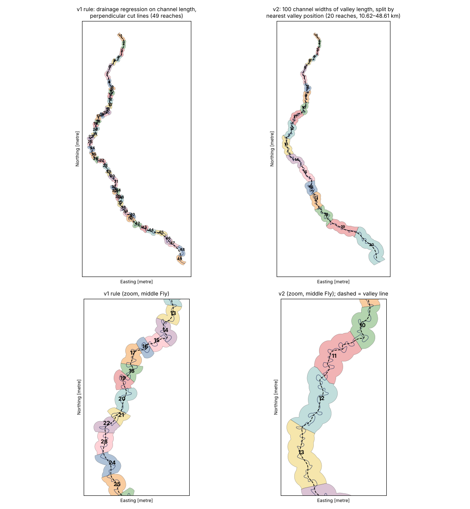
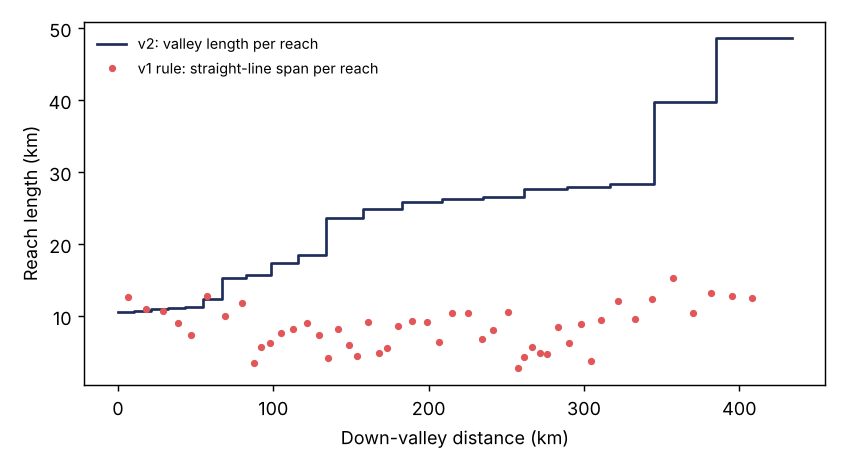
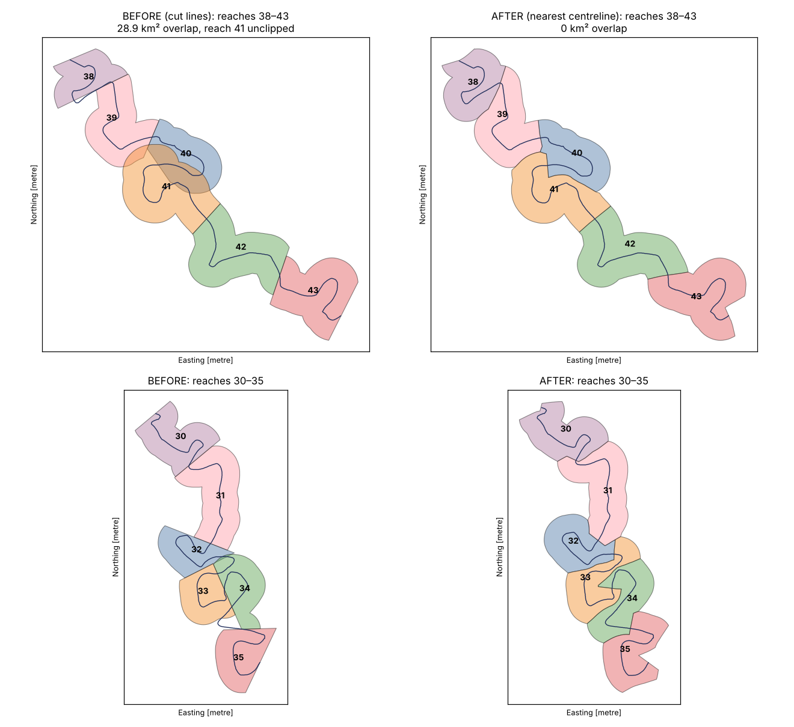

# Reach definition (step `reaches`)

How RivMapper v2 divides a river into analysis reaches: what is computed, which parameters control it, and the literature behind each choice. Code: [`rivmapper_v2/valley.py`](../../rivmapper_v2/valley.py) and [`rivmapper_v2/reaches.py`](../../rivmapper_v2/reaches.py).

## Summary

Reaches are defined by **down-valley length**, not along-channel length. Each reach spans a fixed number of channel widths of valley, **k × W(A)** with k = 80 by default, where **W(A)** is a power law of channel width against drainage area fitted to that river's SWORD node widths. Reaches therefore:

- contain a consistent number of meander wavelengths (~7) and bends (~15), however sinuous the channel is;
- lengthen downstream as the river widens, following the river's own measured hydraulic geometry;
- have along-channel lengths that vary with sinuosity, as they should.

Reach polygons are buffers of each reach centreline, separated from their neighbours by a nearest-centreline partition so they never overlap.

*Ok Tedi–Fly, buffer_width 0.15.* Left: v1 drainage-area regression on channel length (49 reaches). Right: 80 channel widths of valley length (25 reaches); the dashed line is the valley line.

## Why not along-channel length?

v1 set reach length along the channel as `modulator × 0.0668 × A + 14316` m, a regression fitted on the Ganges. Two problems showed up on the Ok Tedi–Fly:

1. **Sinuosity:** with a fixed channel length, a sinuous reach covers little valley distance and few bends. Straight-line span per reach ranged from 2.8 to 15 km, with reach sinuosity from 1.1 to 5.6.
2. **Weak downstream scaling:** the intercept dominates, so channel reach length grew only from 14.4 to 18.2 km while channel width grew from ~130 to ~510 m.

The regression method is still available as `length_method: drainage_regression`.

## Method

### 1. Width model W(A)

Channel width is modelled per river as `W = c · A^b` (W in m, A = SWORD `facc` in km²):

- Fitted to the medians of node width in 20 equal-log bins of drainage area. Using binned medians makes the fit robust to noisy wetted widths, anabranches, and many nodes at similar A.
- The exponent b is constrained to be ≥ 0, so reach length never decreases downstream.
- If A changes by less than 20% along the river, or there are too few bins, a constant (median) width is used.

Using a width model rather than local widths keeps reach length smooth and monotonic. It still steps up at large tributary junctions, where A jumps; on the Fly this happens at the Strickland junction.

*Ok Tedi–Fly:* W = 11.7 · A^0.32, giving 106 m at the Tedi head and 405 m on the lower Fly.

### 2. Valley line

The valley line is the SWORD centreline smoothed at a scale tied to channel width and local sinuosity.

1. **Local width:** a rolling median of node width in log space over 41 nodes (≈ 8 km).
2. **Width-normalised arc length:** s\* = ∫ ds / W. Smoothing with a fixed σ in s\* gives a filter that grows with river size, which handles rivers whose width changes several-fold.
3. **Pass 1:** Gaussian smoothing of x and y against s\* with σ = `valley_sigma_widths` = 15 W. This matches the 50-width Savitzky–Golay window RivMAP uses to build channel-belt centrelines (Schwenk et al., 2017); a 50-sample boxcar is equivalent to σ ≈ 14.
4. **Sinuosity-aware pass 2:**
   - Local sinuosity S is measured from pass 1 over ±25 W.
   - The line is re-smoothed with σ = max(15, `valley_sinuosity_factor` × S) W, with the factor = 6.
   - Why: a Gaussian keeps exp(−2π²σ²/L²) of the amplitude of a wave of length L. Bends must be judged at their *along-channel* wavelength, ≈ S × λ, which is long where S is high. σ ≈ λ_channel/2 keeps less than 1% of bend amplitude, but more than 80% of a valley bend five times longer.
5. **Down-valley distance:** each node's valley distance is the cumulative length of the smoothed line up to that node. This makes it monotonic by construction, and it advances slowly through loops.

Ends are reflection-padded. The first and last ~2σ of the valley line are less reliable.

*Ok Tedi–Fly:* valley length 434 km against 757 km of channel, an overall sinuosity of 1.74.

### 3. Reach breaks

Starting at the upstream end, each reach's valley length is set to `widths_per_reach × W(A)`, evaluated at the reach's upstream end.

- Breaks are placed at those valley distances and mapped to channel distance by interpolating between nodes. Each node's position along the merged channel line is forced to be monotonic first.
- A final remainder shorter than `final_merge_fraction` (0.5) of its nominal length is merged into the reach above.

**Why k = 80:**
- Meander wavelength is ≈ 11 W (Leopold & Wolman, 1960; Williams, 1986), so 80 W is ≈ 7 wavelengths.
- A bend is ≈ 10 W along the channel (Geyman et al., 2025), so 80 W of valley is ≈ 15 bends at modest sinuosity, and more where sinuosity is higher.
- This meets the ≥ 15-bend aggregation of Greenberg & Ganti (2024), and well exceeds the ≥ 3-bend minimum reach scale of Greenberg et al. (2023).

*Ok Tedi–Fly:* 25 reaches, with valley length 8.5 → 32 km downstream (70–81 widths each). Along-channel length is 10.7–53 km, and reach sinuosity 1.15–2.4.

### 4. Reach polygons

- **Buffer:** each reach centreline is buffered by `buffer_width` × the reach's valley length. With 0.15 × 80 W this is a half-width of ≈ 12 W, so the corridor scales with river size rather than with sinuosity.
- **Neighbours:** separated by a nearest-centreline partition (`boundary_method: nearest_centerline`).
  - Points are sampled every 100 m along all reach centrelines.
  - Their Voronoi cells are dissolved by reach, and each buffer is intersected with its reach's cell.
  - Polygons therefore never overlap or leave wedge gaps, even where the channel doubles back. On the Ok Tedi, perpendicular cut lines (`boundary_method: cut_lines`) left 29 km² of overlap at a loop (figure below, drawn with v1-style reaches).

    
- **Head and mouth:** squared off with cuts perpendicular to the valley line.

### Outputs

`{data_root}/{river}/reaches/`:

| File | Contents |
|---|---|
| `{river}_reach_lines.gpkg` | Reach centrelines |
| `{river}_reach_polygons.gpkg` | Reach polygons |
| `{river}_valley_line.gpkg` | The valley line |
| `{river}_reaches_run.yaml` | Parameters, width-model coefficients and diagnostics |

The lines and polygons carry these fields:

| Field | Units | Meaning |
|---|---|---|
| `ds_order` | – | 1 = most upstream |
| `reach_len` | m | Along-channel length |
| `ds_dist` | m | Along-channel distance from the river head to the reach start |
| `valley_len` | m | Down-valley length |
| `valley_dist` | m | Down-valley distance to the reach start |
| `sinuosity` | – | `reach_len / valley_len` |
| `width_ref` | m | W(A) at the reach start |
| `us_drain_ar` | km² | Drainage area at the reach start |
| `reach_ar` | km² | Polygon area |

## Parameters (`reaches:` in `rivmapper.yaml`; all can be set per river)

| Parameter | Default | Meaning |
|---|---|---|
| `length_method` | `valley_widths` | Or `drainage_regression` (v1 rule) |
| `widths_per_reach` | 80 | k: valley length per reach in channel widths |
| `buffer_width` | – (required) | Buffer half-width as a fraction of reach valley length |
| `valley_sigma_widths` | 15 | Base valley-line smoothing scale (W) |
| `valley_sinuosity_factor` | 6 | Smoothing in sinuous reaches = factor × local sinuosity (W) |
| `final_merge_fraction` | 0.5 | Merge a last reach shorter than this × nominal |
| `boundary_method` | `nearest_centerline` | Or `cut_lines` |
| `partition_spacing_m` | 100 | Centreline sampling for the nearest-centreline partition |

## Limitations and planned upgrades

- **Braided and anabranching rivers** (e.g. Bermejo): the SWORD single thread is only a proxy for the channel belt. Its smoothed version should still give a reasonable valley line. The planned upgrade is RivMAP-style: build the valley line from the multi-decade channel belt (union of Landsat water masks or JRC occurrence), taking the centreline as the mean of smoothed belt edges.
- **Sensitivity:** before publication, report results at k = 40, 80 and 160, along with bends and sinuosity per reach.
- **SWORD widths** are wetted widths from a single source, not bankfull widths. The binned power-law fit limits their noise, but the absolute reach length inherits any width bias.
- **Ends:** the first and last reaches sit within the reflection-padded part of the valley line.

## References

- Geyman, E. C., et al. (2025). *Science Advances*, 11, eadu8574. https://doi.org/10.1126/sciadv.adu8574 (mean bend length ≈ 10 W)
- Greenberg, E., Chadwick, A. J., & Ganti, V. (2023). A generalized area-based framework to quantify river mobility from remotely sensed imagery. *JGR: Earth Surface*, 128, e2023JF007189. https://doi.org/10.1029/2023JF007189 (reach scale ≥ 3 bends)
- Greenberg, E., & Ganti, V. (2024). *Earth and Planetary Science Letters*, 634, 118674. https://doi.org/10.1016/j.epsl.2024.118674 (aggregation over > 15 bends; 139 rivers)
- Leopold, L. B., & Wolman, M. G. (1960). River meanders. *GSA Bulletin*, 71, 769–793. https://doi.org/10.1130/0016-7606(1960)71[769:RM]2.0.CO;2 (λ ≈ 11 W)
- Rowland, J. C., et al. (2023). *JGR: Earth Surface*, 128, e2023JF007101. https://doi.org/10.1029/2023JF007101 (Arctic rivers; segment length did not bias erosion rates)
- Schwenk, J., Khandelwal, A., Fratkin, M., Kumar, V., & Foufoula-Georgiou, E. (2017). High spatiotemporal resolution of river planform dynamics from Landsat: The RivMAP toolbox and results from the Ucayali River. *Earth and Space Science*, 4, 46–75. https://doi.org/10.1002/2016EA000196 (valley line from 50 W-smoothed channel-belt edges)
- Schwenk, J., & Hariharan, J. (2021). RivGraph: Automatic extraction and analysis of river and delta channel network topology. *Journal of Open Source Software*, 6(59), 2952. https://doi.org/10.21105/joss.02952 (smoothed valley-line implementation)
- Williams, G. P. (1986). River meanders and channel size. *Journal of Hydrology*, 88, 147–164. https://doi.org/10.1016/0022-1694(86)90202-7 (λ = 7.5 W^1.12)

**Check before citing in a manuscript.** These were gathered by literature review and not all were confirmed against the original text:
- the exact Leopold & Wolman (1960) coefficient (λ = 11.0 W^1.01);
- the full author lists for Geyman et al. (2025) and Rowland et al. (2023);
- whether Greenberg & Ganti (2024) measure along the valley or the channel.
